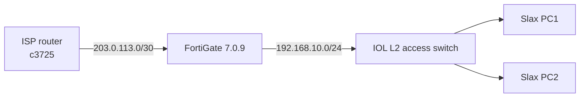
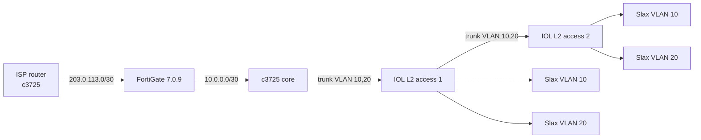

# EVE-NG Cisco + FortiGate Lab Guide

Private guide for building simple **SOHO** and **small-enterprise** networks in
EVE-NG CE using Cisco IOS/IOL routers and switches plus one FortiGate firewall.

> This repository contains **documentation and configuration examples only**.
> It does **not** contain Cisco IOS, IOL, FortiGate, or any other vendor images.
> Use only images you are licensed to use.

## What you will build

### Lab 1 — SOHO



One FortiGate does NAT, DHCP, firewall, and routing. One IOL L2 switch provides
access ports. Two Slax Linux PCs act as clients.

### Lab 2 — Small enterprise



The FortiGate is the edge firewall. A c3725 (or IOL L3) is the internal core
router doing inter-VLAN routing and DHCP. Two IOL L2 switches provide access
ports for two VLANs. Slax PCs are clients.

## Lab inventory

| Role | Image / file | EVE-NG template | Notes |
|---|---|---|---|
| Edge firewall | `fortinet-FGT-v7.0.9-build0444` | `Fortinet` | 4 NICs, telnet console, 1–2 GB RAM |
| Linux clients | `linux-slax-9.11.0` | `Linux` | VNC console, 1 GB RAM recommended |
| Small branch router | `c1710-bk9no3r2sy-mz.124-23.image` | `1710` | Dynamips, 96 MB RAM |
| Main lab router | `c3725-adventerprisek9-mz.124-15.T14.image` | `3725` | Dynamips, 256 MB RAM, NM slots |
| Core / PE router | `c7200-adventerprisek9-mz.152-4.M11.image` | `7206VXR` | Dynamips, 256 MB+ RAM, PA slots |
| Cisco L2 switch | `L2-ADVENTERPRISEK9-M-15.2-20150703.bin` | `Cisco IOL` | IOL L2, set Ethernet to 4/8 |
| Cisco L2 switch | `i86bi_linux_l2-ipbasek9-ms.high_iron_aug9_2017b.bin` | `Cisco IOL` | IOL L2, lighter feature set |
| Cisco L3 router | `L3-ADVENTERPRISEK9-M-15.2-M5.3.bin` | `Cisco IOL` | IOL L3, lightweight routing |
| Cisco L3 router | `i86bi_LinuxL3-AdvEnterpriseK9-M2_157_3_May_2018.bin` | `Cisco IOL` | IOL L3, newer 15.7 image |
| IOL license | `iourc` | — | Hostname-bound license file, not an image |

See [docs/03-image-inventory.md](docs/03-image-inventory.md) for details.

## Quick start

1. Open the EVE-NG UI: `http://192.168.122.40/` (use your own EVE address/password).
2. Confirm the images are present: [docs/03-image-inventory.md](docs/03-image-inventory.md).
3. Build the SOHO lab: [docs/04-soho-lab.md](docs/04-soho-lab.md).
4. Build the small-enterprise lab: [docs/05-small-enterprise-lab.md](docs/05-small-enterprise-lab.md).
5. Use [docs/08-troubleshooting.md](docs/08-troubleshooting.md) if a node will not start.
6. Use [docs/10-cheatsheet.md](docs/10-cheatsheet.md) for common commands.

## Documentation

| Document | Contents |
|---|---|
| [docs/00-glossary.md](docs/00-glossary.md) | Terms: EVE-NG, Dynamips, IOL, FGT, qcow2, iourc |
| [docs/01-lab-overview.md](docs/01-lab-overview.md) | Design goals, addressing, topology choices |
| [docs/02-eve-ng-vm.md](docs/02-eve-ng-vm.md) | Reference EVE-NG VM and image layout |
| [docs/03-image-inventory.md](docs/03-image-inventory.md) | Every image, template, role, and source |
| [docs/04-soho-lab.md](docs/04-soho-lab.md) | Step-by-step SOHO lab |
| [docs/05-small-enterprise-lab.md](docs/05-small-enterprise-lab.md) | Step-by-step small-enterprise lab |
| [docs/06-cisco-switching.md](docs/06-cisco-switching.md) | IOL L2 vs c3725 NM-16ESW; Cisco switch options |
| [docs/07-node-settings.md](docs/07-node-settings.md) | Templates, RAM, NICs, modules, consoles |
| [docs/08-troubleshooting.md](docs/08-troubleshooting.md) | Common failures and fixes |
| [docs/09-licensing.md](docs/09-licensing.md) | Licensing and redistribution rules |
| [docs/10-cheatsheet.md](docs/10-cheatsheet.md) | Quick command reference |

## Example configs

| File | Purpose |
|---|---|
| [configs/fortigate/soho-fgt.conf](configs/fortigate/soho-fgt.conf) | FortiGate for the SOHO lab |
| [configs/fortigate/enterprise-fgt.conf](configs/fortigate/enterprise-fgt.conf) | FortiGate for the enterprise lab |
| [configs/cisco/c3725-isp.conf](configs/cisco/c3725-isp.conf) | ISP router / closed-lab internet stand-in |
| [configs/cisco/c3725-core.conf](configs/cisco/c3725-core.conf) | c3725 core router, VLANs, DHCP, static routing |
| [configs/cisco/iol-l3-core.conf](configs/cisco/iol-l3-core.conf) | IOL L3 alternative to the c3725 core |
| [configs/cisco/iol-l2-soho.conf](configs/cisco/iol-l2-soho.conf) | IOL L2 switch for the SOHO lab |
| [configs/cisco/iol-l2-access.conf](configs/cisco/iol-l2-access.conf) | IOL L2 access switch, VLANs and trunk |
| [configs/cisco/c1710-branch.conf](configs/cisco/c1710-branch.conf) | Optional small branch router |
| [configs/linux/slax-client.md](configs/linux/slax-client.md) | Slax PC DHCP/static commands and tests |

## Repository layout

```text
.
├── README.md
├── LICENSE
├── .gitignore
├── docs/
│   ├── 00-glossary.md
│   ├── 01-lab-overview.md
│   ├── 02-eve-ng-vm.md
│   ├── 03-image-inventory.md
│   ├── 04-soho-lab.md
│   ├── 05-small-enterprise-lab.md
│   ├── 06-cisco-switching.md
│   ├── 07-node-settings.md
│   ├── 08-troubleshooting.md
│   ├── 09-licensing.md
│   └── 10-cheatsheet.md
└── configs/
    ├── fortigate/
    ├── cisco/
    └── linux/
```

## Reference environment

This guide was written against the following reference setup. Your addresses and
credentials will differ.

- Host: Omarchy Linux, AMD Ryzen 7 7700X, 30 GiB RAM, KVM with nested virtualization.
- EVE-NG VM: 8 vCPU, 16 GiB RAM, 60 GiB qcow2 disk, host-passthrough CPU.
- EVE-NG CE 6.2.0-4 on Ubuntu 22.04, IP `192.168.122.40` on the libvirt default network.
- EVE UI: HTTP on port 80. Change the default admin password after installation.
- Images live under `/opt/unetlab/addons/` on the EVE VM.

The 16 GiB VM is enough for both labs if you size nodes sensibly. See
[docs/07-node-settings.md](docs/07-node-settings.md).

## Licensing and disclaimer

Cisco IOS, Cisco IOL, and FortiGate VM images are proprietary. They are **not**
included here and must not be redistributed. You are responsible for complying
with the vendor licenses. The IOL `iourc` file is a hostname-bound license file:
keep it private and do not commit it.

The documentation and example configurations in this repository are provided
under the MIT License. See [LICENSE](LICENSE).
