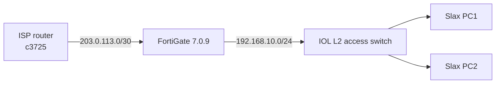

# Lab 1 — SOHO

A small office/home office network with one FortiGate firewall, one Cisco L2
switch, and two Linux PCs. The FortiGate provides NAT, DHCP, firewall policy,
and the default route. The switch provides access ports.

## Topology



## IP plan

| Device | Interface | Address | Notes |
|---|---|---|---|
| ISP | `FastEthernet0/0` | `203.0.113.1/30` | To FortiGate `port1` |
| ISP | `Loopback0` | `8.8.8.8/32` | Internet stand-in |
| FGT | `port1` (WAN) | `203.0.113.2/30` | Default route to `203.0.113.1` |
| FGT | `port2` (LAN) | `192.168.10.1/24` | DHCP server |
| SW | `Ethernet0/0` | — | Access VLAN 10, to FGT `port2` |
| SW | `Ethernet0/1` | — | Access VLAN 10, to PC1 |
| SW | `Ethernet0/2` | — | Access VLAN 10, to PC2 |
| PC1/PC2 | `eth0` | DHCP `.100`–`.199` | Same subnet as the FGT LAN |

## Node list

| Node | EVE template | Image | RAM | NICs |
|---|---|---|---|---|
| `ISP` | `3725` | `c3725-adventerprisek9-mz.124-15.T14.image` | 256 MB | 1 used |
| `FGT` | `Fortinet` | `fortinet-FGT-v7.0.9-build0444` | 2 GB | 2 used |
| `SW` | `Cisco IOL` | `L2-ADVENTERPRISEK9-M-15.2-20150703.bin` | 1 GB | 3 used |
| `PC1` | `Linux` | `linux-slax-9.11.0` | 1 GB | 1 |
| `PC2` | `Linux` | `linux-slax-9.11.0` | 1 GB | 1 |

Total ≈ 5.3 GB, plus the EVE VM overhead. This fits comfortably in 16 GiB.

## Step 1 — Create the lab

1. Open `http://192.168.122.40/` and log in.
2. Choose **Lab → New Lab**.
3. Name it `SOHO-Cisco-FortiGate`.
4. Save the lab.

## Step 2 — Add the nodes

Use **Add Node** and select the template by name. Categories may differ slightly
between EVE-NG versions.

1. **ISP**
   - Template: `3725` (Dynamips).
   - Image: `c3725-adventerprisek9-mz.124-15.T14.image`.
   - RAM: 256 MB.
   - Name: `ISP`.
2. **FGT**
   - Template: `Fortinet`.
   - Image: `fortinet-FGT-v7.0.9-build0444`.
   - RAM: 2048 MB.
   - Name: `FGT`.
3. **SW**
   - Template: `Cisco IOL`.
   - Image: `L2-ADVENTERPRISEK9-M-15.2-20150703.bin`.
   - Ethernet interfaces: 4.
   - RAM: 1024 MB.
   - Name: `SW`.
4. **PC1** and **PC2**
   - Template: `Linux`.
   - Image: `linux-slax-9.11.0`.
   - RAM: 1024 MB, CPU: 1.
   - Names: `PC1`, `PC2`.

If the image dropdown is empty, run `unl_wrapper -a fixpermissions` on the EVE
VM and refresh the browser. See [03-image-inventory.md](03-image-inventory.md).

## Step 3 — Connect the nodes

Use the EVE-NG connect tool (or drag from an interface) to create these links:

| From | To |
|---|---|
| `ISP` `FastEthernet0/0` | `FGT` `port1` |
| `FGT` `port2` | `SW` `Ethernet0/0` |
| `SW` `Ethernet0/1` | `PC1` `eth0` |
| `SW` `Ethernet0/2` | `PC2` `eth0` |

The switch uses access VLAN 10 on all three ports. The FGT LAN interface is
untagged, so no trunk is needed in the SOHO lab.

## Step 4 — Start the nodes

Start the ISP, FGT, and switch first. Start the PCs after the switch is up.

- Cisco consoles are telnet.
- The FortiGate console is telnet (serial).
- Linux consoles are VNC.

The FortiGate may take 2–5 minutes to boot. If the console is blank, wait and
reconnect.

## Step 5 — Configure the ISP router

Open the `ISP` console and apply
[`configs/cisco/c3725-isp.conf`](../configs/cisco/c3725-isp.conf). The key parts:

```text
hostname ISP
interface Loopback0
 ip address 8.8.8.8 255.255.255.255
interface FastEthernet0/0
 ip address 203.0.113.1 255.255.255.252
 no shutdown
```

There is no default route on the ISP. It only needs its connected WAN link and
the loopback. The FortiGate performs NAT, so the ISP does not need a return route
to `192.168.10.0/24`.

Verify:

```text
show ip interface brief
show ip route
ping 203.0.113.2
```

The ping to the FGT WAN address should work once the FGT is configured.

## Step 6 — Configure the FortiGate

Open the `FGT` console. Log in as `admin` with no password, then set a strong
password when prompted.

Apply [`configs/fortigate/soho-fgt.conf`](../configs/fortigate/soho-fgt.conf).
It configures:

- `port1` as WAN `203.0.113.2/30`.
- `port2` as LAN `192.168.10.1/24`.
- A default route to `203.0.113.1`.
- DHCP on `port2`, pool `192.168.10.100`–`192.168.10.199`.
- A LAN-to-WAN firewall policy with NAT enabled.

Key commands:

```text
config system interface
    edit "port1"
        set mode static
        set ip 203.0.113.2 255.255.255.252
        set allowaccess ping
    next
    edit "port2"
        set mode static
        set ip 192.168.10.1 255.255.255.0
        set allowaccess ping https ssh
    next
end

config router static
    edit 1
        set gateway 203.0.113.1
        set device "port1"
    next
end
```

Verify:

```text
get system interface physical
get router info routing-table all
show system dhcp server
```

If the WAN interface is up and the default route is present, `ping 203.0.113.1`
from the FortiGate console should succeed.

## Step 7 — Configure the switch

Open the `SW` console and apply
[`configs/cisco/iol-l2-soho.conf`](../configs/cisco/iol-l2-soho.conf):

```text
hostname SOHO-SW
vlan 10
 name USERS
exit
interface Ethernet0/0
 description UPLINK-TO-FGT
 switchport mode access
 switchport access vlan 10
interface Ethernet0/1
 description PC1
 switchport mode access
 switchport access vlan 10
interface Ethernet0/2
 description PC2
 switchport mode access
 switchport access vlan 10
```

Verify:

```text
show vlan brief
show interfaces status
show interfaces switchport
```

All three ports should be in VLAN 10 and in the `connected` state.

## Step 8 — Configure the PCs

Open each Linux VNC console. Find the interface name:

```bash
ip link
```

Usually it is `eth0`. Request DHCP:

```bash
dhclient eth0
# If dhclient is unavailable:
# udhcpc -i eth0
ip addr show eth0
ip route
```

Expected result:

- `PC1` gets an address in `192.168.10.100`–`192.168.10.199`.
- Default gateway is `192.168.10.1`.
- `PC2` gets a different address from the same pool.

If DHCP does not work, configure a static address for testing:

```bash
ip addr add 192.168.10.101/24 dev eth0
ip link set eth0 up
ip route add default via 192.168.10.1
```

Use `.101` for PC1 and `.102` for PC2 to avoid conflicts.

## Step 9 — Verify end to end

From `PC1`:

```bash
ping -c 4 192.168.10.1       # FGT LAN
ping -c 4 192.168.10.102    # PC2 (use PC2's actual address)
ping -c 4 203.0.113.1       # ISP WAN
ping -c 4 8.8.8.8           # ISP loopback, proves NAT + default route
```

From the FortiGate console:

```text
get system arp
get router info routing-table all
diagnose sniffer packet port2 'icmp' 4
```

From the ISP console:

```text
show ip interface brief
show ip route
show ip arp
```

Expected: PC1 can reach PC2, the FGT LAN, the ISP WAN, and `8.8.8.8`. The last
test proves that the FortiGate is routing, NATing, and applying the firewall
policy.

## Step 10 — Save

- Cisco: `write memory` on the ISP and switch.
- FortiGate: configuration changes are saved automatically.
- EVE-NG: save the lab.

## Optional internet access

Replace the ISP router with an EVE-NG **Cloud** connected to a NAT-enabled host
interface:

1. Add a Cloud node.
2. Connect the Cloud to `FGT port1`.
3. Set `port1` to DHCP (`set mode dhcp`) or a static address on the host lab
   network.
4. Configure DNS on the FortiGate and PCs.
5. Keep the LAN-to-WAN NAT policy.

This depends on your host's bridge/NAT setup. The closed-lab ISP router is more
reproducible.

## Extensions

- Add a second VLAN and convert `port2` to a trunk with VLAN subinterfaces on
  the FortiGate, or add a c3725/IOL L3 core for inter-VLAN routing.
- Add DHCP reservations for the PCs.
- Add firewall address objects and a deny policy for one PC.
- Add a site-to-site VPN or an IPsec tunnel to a second FortiGate if you have
  another FGT image/license.
- Add a c1710 as a small branch router behind the FortiGate.
- Replace the ISP router with the enterprise lab topology to practice
  inter-VLAN routing and trunking.

## Troubleshooting

- FGT console blank: wait 2–5 minutes; confirm 2 GB RAM.
- PC gets no DHCP address: confirm `port2` is connected to `SW Ethernet0/0`,
  all switch ports are VLAN 10, and the FGT DHCP server is enabled.
- PC can ping the FGT LAN but not `8.8.8.8`: check the FGT default route,
  NAT policy, and the ISP link.
- Switch ports are down: check the EVE links and start order.
- IOL node will not start: check the `iourc` file and hostname.

See [08-troubleshooting.md](08-troubleshooting.md).
