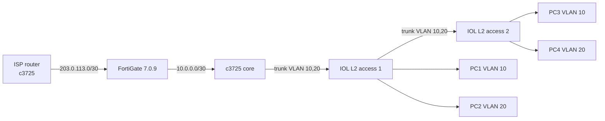

# Lab 2 — Small enterprise

A small enterprise network with a FortiGate edge firewall, a Cisco core router,
two Cisco access switches, two VLANs, and four Linux PCs.

- The **FortiGate** is the edge: WAN, NAT, firewall policy.
- The **core router** does inter-VLAN routing, DHCP, and the default route to
  the FortiGate.
- The **access switches** provide VLAN 10 and VLAN 20 access ports. `SW1` trunks
  to the core; `SW2` trunks to `SW1`.
- The **Slax PCs** are clients on both VLANs.

## Topology



The core has one trunk to `SW1`. `SW1` and `SW2` are connected with a second
trunk. This keeps one routed interface per VLAN on the core and avoids two
separate core links sharing the same VLAN subnets.

An IOL L3 router can replace the c3725 core; see
[`configs/cisco/iol-l3-core.conf`](../configs/cisco/iol-l3-core.conf). It uses
`Ethernet0/0` to the FortiGate and `Ethernet0/1` to `SW1` — the same single-trunk
design.

## IP plan

| Device | Interface | Address | Notes |
|---|---|---|---|
| ISP | `FastEthernet0/0` | `203.0.113.1/30` | To FGT `port1` |
| ISP | `Loopback0` | `8.8.8.8/32` | Internet stand-in |
| FGT | `port1` (WAN) | `203.0.113.2/30` | Default route to `203.0.113.1` |
| FGT | `port2` (LAN) | `10.0.0.1/30` | To CORE `Fa0/0` |
| CORE | `FastEthernet0/0` | `10.0.0.2/30` | Default route to `10.0.0.1` |
| CORE | `Fa0/1.10` | `10.10.0.1/24` | VLAN 10 gateway |
| CORE | `Fa0/1.20` | `10.20.0.1/24` | VLAN 20 gateway |
| SW1 | `Ethernet0/0` | — | 802.1Q trunk to CORE |
| SW1 | `Ethernet0/3` | — | 802.1Q trunk to SW2 |
| SW2 | `Ethernet0/0` | — | 802.1Q trunk to SW1 |
| SW1/SW2 | `Ethernet0/1` | — | Access VLAN 10, PC |
| SW1/SW2 | `Ethernet0/2` | — | Access VLAN 20, PC |
| PCs | `eth0` | DHCP | VLAN 10 or 20 |

DHCP pools:

- VLAN 10: `10.10.0.100`–`10.10.0.199`, gateway `10.10.0.1`.
- VLAN 20: `10.20.0.100`–`10.20.0.199`, gateway `10.20.0.1`.

## Node list

| Node | EVE template | Image | RAM | Notes |
|---|---|---|---|---|
| `ISP` | `3725` | `c3725-adventerprisek9-mz.124-15.T14.image` | 256 MB | Internet stand-in |
| `FGT` | `Fortinet` | `fortinet-FGT-v7.0.9-build0444` | 2 GB | Edge firewall |
| `CORE` | `3725` | `c3725-adventerprisek9-mz.124-15.T14.image` | 256 MB | No extra module |
| `SW1` | `Cisco IOL` | `L2-ADVENTERPRISEK9-M-15.2-20150703.bin` | 1 GB | Ethernet = 4 |
| `SW2` | `Cisco IOL` | `L2-ADVENTERPRISEK9-M-15.2-20150703.bin` | 1 GB | Ethernet = 4 |
| `PC1`–`PC4` | `Linux` | `linux-slax-9.11.0` | 1 GB | 1 NIC each |

Total ≈ 8.5 GB, plus EVE overhead. Fits in 16 GiB.

## Step 1 — Create the lab

1. EVE UI → **Lab → New Lab**.
2. Name it `Small-Enterprise-Cisco-FortiGate`.
3. Save.

## Step 2 — Add the nodes

1. **ISP** — template `3725`, image
   `c3725-adventerprisek9-mz.124-15.T14.image`, 256 MB.
2. **FGT** — template `Fortinet`, image
   `fortinet-FGT-v7.0.9-build0444`, 2048 MB.
3. **CORE** — template `3725`, same image, 256 MB. No extra module is needed.
4. **SW1** and **SW2** — template `Cisco IOL`, image
   `L2-ADVENTERPRISEK9-M-15.2-20150703.bin`, Ethernet interfaces = 4, 1024 MB.
5. **PC1**–**PC4** — template `Linux`, image `linux-slax-9.11.0`, 1024 MB,
   CPU = 1.

## Step 3 — Connect

| From | To |
|---|---|
| `ISP` `Fa0/0` | `FGT` `port1` |
| `FGT` `port2` | `CORE` `Fa0/0` |
| `CORE` `Fa0/1` | `SW1` `Ethernet0/0` |
| `SW1` `Ethernet0/3` | `SW2` `Ethernet0/0` |
| `SW1` `Ethernet0/1` | `PC1` `eth0` |
| `SW1` `Ethernet0/2` | `PC2` `eth0` |
| `SW2` `Ethernet0/1` | `PC3` `eth0` |
| `SW2` `Ethernet0/2` | `PC4` `eth0` |

`CORE Fa0/1`, `SW1 E0/0`, `SW1 E0/3`, and `SW2 E0/0` are trunks carrying VLAN 10
and 20. There is one active Layer 2 path between the switches.

`SW2 E0/3` is not used in this topology; the switch template still has four
ports so the same switch configuration fits both nodes.

## Step 4 — Start

Start `ISP`, `FGT`, `CORE`, `SW1`, and `SW2`. Start the PCs after the switches
are up. Wait for the FortiGate (2–5 minutes).

## Step 5 — Configure the ISP

Apply [`configs/cisco/c3725-isp.conf`](../configs/cisco/c3725-isp.conf). It is
the same ISP router as the SOHO lab:

```text
hostname ISP
interface Loopback0
 ip address 8.8.8.8 255.255.255.255
interface FastEthernet0/0
 ip address 203.0.113.1 255.255.255.252
 no shutdown
```

Verify with `show ip interface brief` and `show ip route`.

## Step 6 — Configure the FortiGate

Log in as `admin`, set a password, then apply
[`configs/fortigate/enterprise-fgt.conf`](../configs/fortigate/enterprise-fgt.conf).
It configures:

- `port1` WAN `203.0.113.2/30`, default route to `203.0.113.1`.
- `port2` LAN `10.0.0.1/30`.
- Static routes to `10.10.0.0/24` and `10.20.0.0/24` via `10.0.0.2`.
- A LAN-to-WAN firewall policy with NAT.

Key parts:

```text
config router static
    edit 1
        set gateway 203.0.113.1
        set device "port1"
    next
    edit 2
        set dst 10.10.0.0 255.255.255.0
        set gateway 10.0.0.2
        set device "port2"
    next
    edit 3
        set dst 10.20.0.0 255.255.255.0
        set gateway 10.0.0.2
        set device "port2"
    next
end
```

Verify:

```text
get system interface physical
get router info routing-table all
```

The routing table should show the default route and both `10.x` VLAN routes.

## Step 7 — Configure the core router

Apply [`configs/cisco/c3725-core.conf`](../configs/cisco/c3725-core.conf). The
important pieces:

```text
hostname CORE
ip routing

interface FastEthernet0/0
 description TO-FGT
 ip address 10.0.0.2 255.255.255.252
 no shutdown

interface FastEthernet0/1
 description TO-SW1
 no ip address
 no shutdown
interface FastEthernet0/1.10
 encapsulation dot1Q 10
 ip address 10.10.0.1 255.255.255.0
interface FastEthernet0/1.20
 encapsulation dot1Q 20
 ip address 10.20.0.1 255.255.255.0

ip route 0.0.0.0 0.0.0.0 10.0.0.1
```

The config file also creates DHCP pools for VLAN 10 and VLAN 20.

Verify:

```text
show ip interface brief
show ip route
show ip dhcp binding
show ip dhcp pool
```

Expected: connected routes for `10.0.0.0/30`, `10.10.0.0/24`, and
`10.20.0.0/24`; a default route via `10.0.0.1`.

If you use the IOL L3 core instead, apply
[`configs/cisco/iol-l3-core.conf`](../configs/cisco/iol-l3-core.conf) and use
`Ethernet0/0` (FGT) and `Ethernet0/1` (SW1).

## Step 8 — Configure the access switches

Apply [`configs/cisco/iol-l2-access.conf`](../configs/cisco/iol-l2-access.conf)
to `SW1` and `SW2`, changing the hostname on each.

Key configuration:

```text
vlan 10
 name USERS
vlan 20
 name SERVERS

interface Ethernet0/0
 description TRUNK-UPSTREAM
 switchport mode trunk
 switchport trunk allowed vlan 10,20
! If supported by the image:
! switchport trunk encapsulation dot1q

interface Ethernet0/3
 description TRUNK-TO-SW2-ON-SW1
 switchport mode trunk
 switchport trunk allowed vlan 10,20

interface Ethernet0/1
 description PC-VLAN10
 switchport mode access
 switchport access vlan 10

interface Ethernet0/2
 description PC-VLAN20
 switchport mode access
 switchport access vlan 20
```

`Ethernet0/3` is the inter-switch trunk on `SW1`. On `SW2` it is unused, but
leaving it configured as a trunk is harmless.

Verify on each switch:

```text
show vlan brief
show interfaces trunk
show interfaces status
show spanning-tree
```

Expected:

- `SW1`: `Ethernet0/0` and `Ethernet0/3` are trunks carrying VLAN 10 and 20.
- `SW2`: `Ethernet0/0` is a trunk carrying VLAN 10 and 20.
- `Ethernet0/1` is access VLAN 10; `Ethernet0/2` is access VLAN 20 on both.

## Step 9 — Configure the PCs

Open each VNC console and run:

```bash
ip link
dhclient eth0
# or: udhcpc -i eth0
ip addr show eth0
ip route
```

Expected:

| PC | Switch port | VLAN | Address range |
|---|---|---|---|
| PC1 | SW1 `Ethernet0/1` | 10 | `10.10.0.100`–`10.10.0.199` |
| PC2 | SW1 `Ethernet0/2` | 20 | `10.20.0.100`–`10.20.0.199` |
| PC3 | SW2 `Ethernet0/1` | 10 | `10.10.0.100`–`10.10.0.199` |
| PC4 | SW2 `Ethernet0/2` | 20 | `10.20.0.100`–`10.20.0.199` |

If DHCP does not work, use static addresses for testing:

- PC1: `10.10.0.101/24`, gateway `10.10.0.1`
- PC2: `10.20.0.101/24`, gateway `10.20.0.1`
- PC3: `10.10.0.102/24`, gateway `10.10.0.1`
- PC4: `10.20.0.102/24`, gateway `10.20.0.1`

## Step 10 — Verify end to end

From PC1 (VLAN 10):

```bash
ping -c 4 10.10.0.1       # core VLAN 10 gateway
ping -c 4 10.20.0.101     # PC2 on VLAN 20, inter-VLAN routing
ping -c 4 10.10.0.102     # PC3, same VLAN, across the two switches
ping -c 4 10.0.0.1        # FGT LAN
ping -c 4 8.8.8.8         # ISP loopback, proves NAT + default route
```

From PC2 (VLAN 20), test the reverse path:

```bash
ping -c 4 10.10.0.101
ping -c 4 8.8.8.8
```

From the core router:

```text
show ip route
show ip dhcp binding
show ip arp
```

From the FortiGate:

```text
get router info routing-table all
get system arp
diagnose sniffer packet port2 'icmp' 4
```

Expected: same-VLAN traffic stays at Layer 2; inter-VLAN traffic is routed by
the core; Internet-bound traffic is routed to the FortiGate and NATed.

## Optional — OSPF instead of static routes

Replace the static routes with OSPF if you want dynamic routing:

- On the core, add `router ospf 1` and advertise `10.0.0.0/30`,
  `10.10.0.0/24`, and `10.20.0.0/24`.
- On the FortiGate, enable OSPF and advertise `10.0.0.0/30`.
- Keep the FortiGate default route to the ISP.

The static setup is easier to troubleshoot; use OSPF only after the static lab
works.

## Optional — c1710 branch

Add a c1710 as a small branch behind the core:

- On `SW1`, raise the IOL Ethernet count to 5 (stop/wipe/start the node), then
  use `Ethernet0/4` as access VLAN 30.
- Connect the c1710 uplink to that port.
- On the core, add `interface Fa0/1.30` with
  `encapsulation dot1Q 30` and `ip address 10.30.0.1 255.255.255.0`.
- On the core, add `ip route 10.31.0.0 255.255.255.0 10.30.0.2`.
- On the FortiGate, add a static route to `10.31.0.0/24` via `10.0.0.2`.
- Apply [`configs/cisco/c1710-branch.conf`](../configs/cisco/c1710-branch.conf).

On `SW1`, add:

```text
vlan 30
 name BRANCH
interface Ethernet0/4
 switchport mode access
 switchport access vlan 30
```

The branch config uses `10.30.0.2/24` on the uplink and a loopback
`10.31.0.1/24` as a stand-in for the branch LAN. Check interface names with
`show ip interface brief` on the 1710.

## Optional internet access

Replace the ISP router with an EVE-NG Cloud connected to a NAT-enabled host
interface, set the FGT WAN to DHCP or a host-lab static address, and configure
DNS. The closed-lab ISP router is more reproducible.

## Troubleshooting

- **Core subinterfaces not up:** check the `CORE`–`SW1` trunk and the physical
  link; `show interfaces trunk`.
- **SW2 clients cannot reach the core:** check the `SW1 E0/3`–`SW2 E0/0` trunk
  and the allowed VLAN list.
- **PC gets the wrong VLAN address:** check the access port VLAN and the trunk
  allowed VLAN list.
- **No inter-VLAN routing:** confirm `ip routing` on the core, both subinterfaces,
  and the PC default gateways.
- **No Internet:** check the FGT default route, the two `10.x` static routes,
  the NAT policy, and the ISP link.
- **IOL node will not start:** check `iourc`, hostname, and executable bit.

See [08-troubleshooting.md](08-troubleshooting.md).
